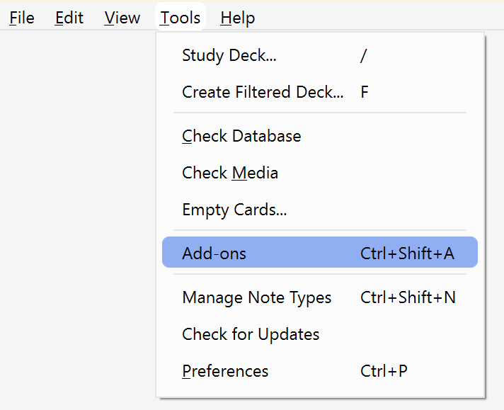
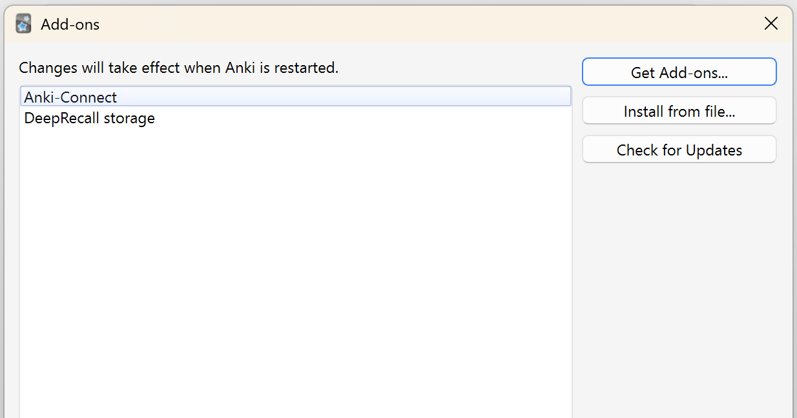

# AI setup

AI feedback is off by default. When it is on, the card sends your question, the real answer and what you wrote (text, or a picture of your drawing) to the provider you choose, then shows how complete your answer was and what to add.

## Quick setup

1. **On a computer,** install the [desktop add-on](#desktop-add-on) first, so Anki keeps your settings.
2. On the question side of a card, tick **AI feedback**.
3. In the panel that opens, pick a provider, paste its key and choose a passphrase.
4. Press **Done**.

Every card in that deck now gets feedback until you untick the box.

Not sure which provider? Start with **Puter**, which has a free monthly allowance. Use **Claude** or **OpenAI** to pay as you go, or **Ollama** or **LM Studio** to keep everything on your computer.

## Providers

| Provider                | Cost                              | Works on     | You need                        |
| ----------------------- | --------------------------------- | ------------ | ------------------------------- |
| [Puter](#puter)         | Monthly free allowance, then paid | Everywhere   | A Puter account and token       |
| [Claude](#claude)       | Pay per use                       | Everywhere   | An Anthropic API key and credit |
| [OpenAI](#openai)       | Pay per use                       | Everywhere   | An OpenAI API key and credit    |
| [Ollama](#ollama)       | Free                              | Desktop only | Ollama and a model installed    |
| [LM Studio](#lm-studio) | Free                              | Desktop only | LM Studio and a model installed |

A model that cannot read images works for typed answers only.

The AI switch is per deck. The provider, model and key are per device and shared by all decks.

### Puter

1. Sign up at [puter.com](https://puter.com).
2. Open [puter.com/dashboard#account](https://puter.com/dashboard#account) and create a token in the **Auth Token** section. Give it an expiry. A separate Puter account for Anki keeps your main one out of it.
3. In the card's panel, choose **Puter**, paste the token, choose a passphrase and press **Save**.

### Claude

1. Create an account at [console.anthropic.com](https://console.anthropic.com), add a little credit and set a monthly spend limit.
2. Create a key at [console.anthropic.com/settings/keys](https://console.anthropic.com/settings/keys). It is shown only once, so copy it straight away.
3. In the card's panel, choose **Claude**, paste the key, choose a passphrase and press **Save**.

Choose **Other…** in the model list to type any model name.

### OpenAI

1. Create an account at [platform.openai.com](https://platform.openai.com) and add a little credit under **Billing**. API credit is separate from ChatGPT.
2. Create a key at [platform.openai.com/api-keys](https://platform.openai.com/api-keys). Make it **Restricted**, set **Model capabilities → Request** and leave everything else on **None**. Set a spend limit in your billing limits.
3. In the card's panel, choose **OpenAI**, paste the key, choose a passphrase and press **Save**.

Choose **Other…** in the model list to type any model name.

### Ollama

Ollama runs a model on your computer, so nothing leaves it. It works on desktop only.

1. Install [Ollama](https://ollama.com) and keep it running.
2. To use drawn answers, download a model that can read images, for example `ollama pull gemma4:e4b`.
3. In the card's panel, choose **Ollama**. It lists your installed models and marks any that are text only. The address is `http://localhost:11434`. It has to be on this computer, so any other address is refused.

Choose **Other…** to type a model name that is not in the list.

If the card cannot reach Ollama, check that it is running. If it is running and still refuses, set the `OLLAMA_ORIGINS` environment variable to `*` and restart Ollama. This works in Anki on a Mac.

### LM Studio

LM Studio runs a model on your computer, so nothing leaves it. It works on desktop only.

1. Install [LM Studio](https://lmstudio.ai) and download a model. To use drawn answers, choose one that can read images.
2. Load the model. The card needs only a few thousand tokens, so a context length of 8192 is enough. A very large context length can fail with "failed to allocate buffer for kv cache" on a computer with little memory.
3. Go to **Settings** → **Local Model API**. Turn on **Local API server** and **CORS**, then copy the **Base URL**.
4. In the card's panel, choose **LM Studio**. It lists your models, hides embedding models and marks any that are text only. Paste the **Base URL** into the **Address**, for example `http://localhost:1234/v1`.

Choose **Other…** to type a model name that is not in the list.

If the card cannot reach LM Studio, check that **Local API server** and **CORS** are on in **Settings** → **Local Model API**, and that the address matches the Base URL. This works in Anki for Windows.

## Your key and passphrase

When you save a Puter, Claude or OpenAI key, you also choose a passphrase. The key is stored on that device, scrambled with the passphrase, and you type the passphrase once each time Anki starts. If you forget it, press **Forgot passphrase? Remove key** and add the key again. The passphrase protects the saved copy but not a key you have already unlocked; see the [threat model](threat-model.md).

## Desktop add-on

Desktop Anki forgets what a card stores whenever it closes. Without the add-on, a computer loses your provider, model, saved keys, per-deck switches and Type/Draw choices at every restart. Phones keep them, so this is for computers only. The card works without it.

1. Download `deeprecall.ankiaddon` from the [latest release](../../../releases/latest), or run `npm run build:addon` to make `addon/deeprecall.ankiaddon`.
2. In Anki, choose **Tools → Add-ons → Install from file…** and pick the file.
3. Restart Anki.

To check it works, set a provider, tick AI feedback and choose Draw on a card. Close Anki completely and reopen it. Your choices should still be there, and only the passphrase is asked for.

To remove it, choose **Tools → Add-ons → DeepRecall storage → Delete** and restart Anki.

### What the add-on does

It answers only messages that start with `deeprecall:` from the review screen. It stores only entries whose names start with `dr:`, `ai:`, `writeMode:` or `puterToken`, and it makes no network requests. The code is about 70 lines: [`addon/__init__.py`](../addon/__init__.py).

Keys are stored as the card stores them, encrypted with your passphrase. The exception is a Puter token saved before passphrases existed, which stays plain text until you press **Protect with a passphrase** in the card's AI settings. The data is in the add-on's `meta.json` in Anki's add-ons folder, so anyone who can read that folder can read the encrypted keys. Use a long passphrase. To clear what it stored without deleting it, open the add-on's **Config** and set `data` to `{}`.

The add-on works in Anki for Windows, and its logic is tested against a stand-in. Other versions of Anki are untested, so if it fails, open an issue with your Anki version.

## Changing the prompt

The instructions sent to the model are in [`card/back.html`](../card/back.html). `SYSTEM` holds the marking instructions, and `HANDWRITING` is added for drawn answers. To change them in Anki, edit the same text in the **Back Template** under **Cards…**. Running the installer again replaces your edits.

## Keeping costs down

The card:

- sends one request per marked answer, and nothing when AI feedback is off;
- crops drawings to your writing and sends them no larger than 512 pixels on the long side, and sends typed answers as plain text;
- caps replies at 900 tokens;
- never retries on its own, so a failed or hung request is cut off after a time limit and only **Try again** sends another.

You can:

- start with the cheapest model in the list, such as GPT-6 Luna, Claude Haiku 5.5 or GPT-5 mini;
- type your answers when you can, because text costs less than a picture;
- switch AI feedback on only for the decks where you want it;
- use Ollama or LM Studio if you want it free;
- set a spend limit on your key and check your provider's usage page for the first few days.
