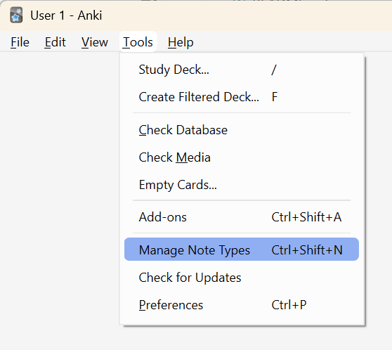
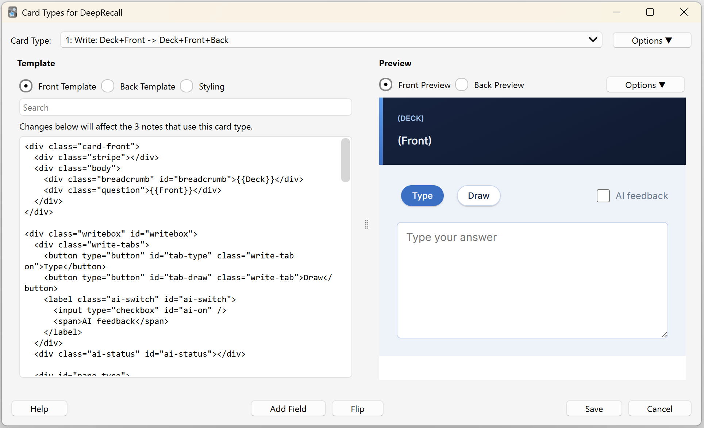

# Install guide

This takes about five minutes and needs no programming. It adds a new note type and leaves your existing ones alone. Back up your Anki collection first.

## 1. Get the files

Open the [`dist`](../dist) folder in this repository. You need `front.html`, `back.html` and `style.css`. In step 3 you open each one and copy its contents with the **Copy raw file** button at the top right of the file view.

## 2. Make a note type

1. In Anki, choose **Tools → Manage Note Types**.
2. Click **Add**, choose **Add: Basic**, and click **OK**.
3. Name it `DeepRecall` and click **OK**.



## 3. Paste the files

1. In the list, select **DeepRecall** and click **Cards**.
2. Click in the **Front Template** box, press **Ctrl+A** (**Cmd+A** on a Mac) and paste `front.html`.
3. Click **Back Template**, select all and paste `back.html`.
4. Click **Styling**, select all and paste `style.css`.
5. Click **Save**.



## 4. Make a card

Choose **Add**, set **Type** to `DeepRecall`, pick a deck, fill in **Front** and **Back**, and click **Add**. When you review the card you should see a box to type in, with **Type** and **Draw** tabs above it.

To move existing cards to this note type, select them in **Browse**, choose **Notes → Change Note Type…**, and map your question field to `Front` and your answer field to `Back`.

## 5. Phone

Sync Anki on the computer, then sync on your phone. The note type comes across with its cards.

## Editing the card

Choose **Tools → Manage Note Types → DeepRecall → Cards**, change the front template, back template or styling, and click **Save**. The preview on the right shows the result. Keep a copy of the original files from [`dist/`](../dist) so you can paste them back. An update replaces your edits.

The Anki manual explains [card templates](https://docs.ankiweb.net/templates/intro.html) and [styling](https://docs.ankiweb.net/templates/styling.html).

## Updating

New versions change the three files. Repeat step 3 with the new ones. Your notes and cards are not touched, but your edits to the templates are replaced.

## Install with a command

With [Node.js](https://nodejs.org) 22 or later and the [AnkiConnect](https://ankiweb.net/shared/info/2055492159) add-on, and Anki open:

```
node scripts/install.mjs
```

This adds or updates the `DeepRecall` note type and, the first time, a `Deep Recall Sample` deck with three cards. Close any Browse, Add or note-editor windows first, because Anki refuses the write while they are open.

## Next

[Set up AI feedback](ai-setup.md).
