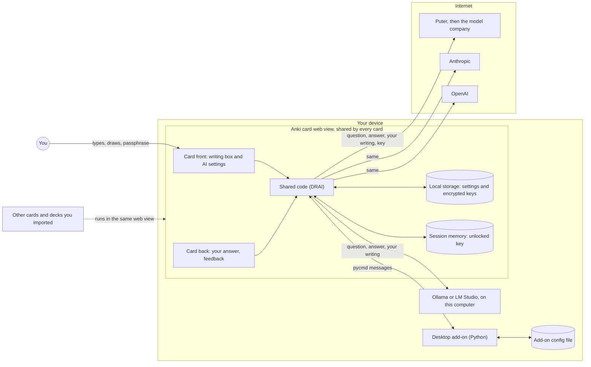
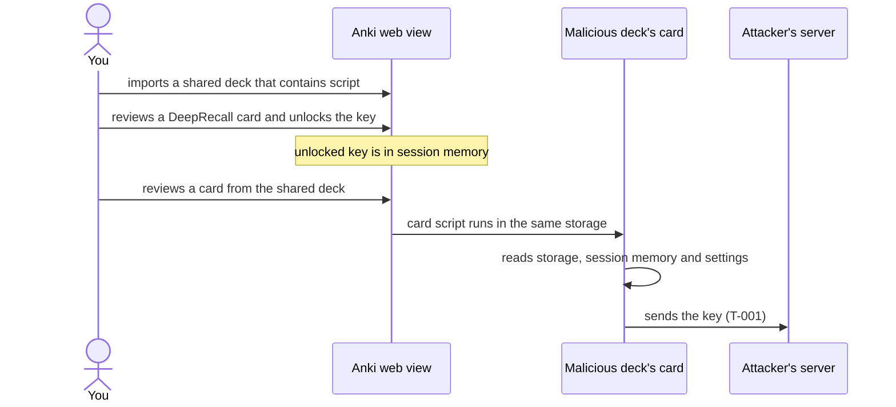

# Threat model

This threat model follows the four questions from [Threat modeling your generative AI workload to evaluate security risk](https://aws.amazon.com/blogs/security/threat-modeling-your-generative-ai-workload-to-evaluate-security-risk/) (AWS Security Blog), which uses Adam Shostack's framing:

1. [What are we working on?](#1-what-are-we-working-on)
2. [What can go wrong?](#2-what-can-go-wrong)
3. [What are we going to do about it?](#3-what-are-we-going-to-do-about-it)
4. [Did we do a good enough job?](#4-did-we-do-a-good-enough-job)

**Short version:** a card runs inside Anki's web view, and every card in Anki shares the same storage. Keys are encrypted at rest, but they cannot be protected from a malicious card in the same Anki. The most useful things you can do are to import only decks you trust and to use spend-limited keys.

It is a living document. Version 0.1, last reviewed with the first release.

---

## 1. What are we working on?

### Business context

DeepRecall is an Anki note type. You write or draw an answer, and optionally an AI model reads it and says how complete it was. It is open source, has no server, no account and no telemetry, and is used by individuals studying with their own Anki.

- **Criticality:** low. It is a study aid. Nothing here is safety-critical or a system of record.
- **Data it handles:** the text of your cards, what you write or draw, and **secrets** (API keys and tokens) that can spend money.
- **Main concerns:** confidentiality of your keys and, to a lesser degree, of your card content. Integrity of the settings. Availability matters little, but a failure must never block a review.

### Assets

| ID  | Asset                                                                 | Why it matters                                                                   |
| --- | --------------------------------------------------------------------- | -------------------------------------------------------------------------------- |
| A1  | API keys and tokens (Puter, Claude, OpenAI)                           | A leaked key spends someone else's money or allowance                            |
| A2  | What you write or draw, and your card content                         | May be private or exam-restricted; sent to an AI provider when AI feedback is on |
| A3  | Settings (provider, model, local server addresses, per-deck switches) | Tampering can redirect where answers are sent                                    |
| A4  | Your Anki collection                                                  | The card never reads or writes it                                                |
| A5  | Your AI account balance or free allowance                             | What an attacker would drain                                                     |

### Architecture and data flow

**Trust boundaries.** (1) Everything inside the Anki web view trusts everything else in it, including other decks' cards. This is the weakest boundary. (2) The add-on runs in Anki's Python process and is reached only through `pycmd`. (3) Everything on the internet is untrusted, including the model's reply.

### Assumptions

- You install the card and add-on from this repository (or build them yourself).
- You may import decks from other people, and a deck can contain script.
- Anki's web view keeps its storage away from websites and other apps.
- Your device is not already compromised, and you choose a passphrase worth guessing against.
- Providers are reached over HTTPS; Ollama and LM Studio over HTTP to your own computer.
- Model output is untrusted text. It is shown, never run.

### Key design decisions

| Decision                                                           | Why                                                              |
| ------------------------------------------------------------------ | ---------------------------------------------------------------- |
| No server, no telemetry                                            | Nothing for us to leak, and nothing to trust but your own device |
| Keys stay on the device and never go in notes                      | Notes sync to AnkiWeb and travel with shared decks               |
| Keys are encrypted with a passphrase                               | A copy of the storage or a backup is not enough to use a key     |
| AI is off by default and switched on per deck                      | Nothing is sent anywhere until you choose                        |
| One key per provider; switching never deletes another              | Keys are often shown once, so losing one is costly               |
| The model's reply is forced into a fixed shape and it has no tools | A misled model can only give a poor rating                       |
| The add-on is tiny, with an allowlist                              | Less code to trust                                               |
| Failures show a message, never block a review                      | Availability of the study session comes first                    |

---

## 2. What can go wrong?

Threats are written as `A [threat source] with [prerequisites] can [threat action], which leads to [threat impact], negatively impacting [impacted assets].` Categories are STRIDE (Spoofing, Tampering, Repudiation, Information disclosure, Denial of service, Elevation of privilege). Resources used: OWASP Top 10 for LLM Applications, MITRE ATLAS.

| ID    | Threat statement                                                                                                                                                                                                                                                                                                              | STRIDE                 | Priority           |
| ----- | ----------------------------------------------------------------------------------------------------------------------------------------------------------------------------------------------------------------------------------------------------------------------------------------------------------------------------- | ---------------------- | ------------------ |
| T-001 | A **deck author** whose shared deck contains script, **once you import it into the same Anki**, can read the card storage and any unlocked key and send them to a server, which leads to **theft of the key**, negatively impacting **A1 and A5**.                                                                            | Information disclosure | **High**           |
| T-002 | A **deck author** with the same prerequisite can **change the saved settings** (the provider, model, local server address or per-deck switch), which leads to **your question, answer and writing going to a different provider than you chose, or to another program on your computer**, negatively impacting **A2 and A3**. | Tampering              | Low                |
| T-003 | A **person who copies your files** (a phone backup or the add-on's config file) can **guess the passphrase offline**, which leads to **recovery of the key**, negatively impacting **A1 and A5**.                                                                                                                             | Information disclosure | Medium             |
| T-004 | **Anyone who can read your storage**, with a Puter token saved before passphrases existed and not yet protected, can **read it as plain text**, which leads to **use of your Puter allowance**, negatively impacting **A1 and A5**.                                                                                           | Information disclosure | Medium             |
| T-005 | A **compromised Puter script** (served from `js.puter.com` when you use Puter) can **read everything the page can read**, which leads to **key or content theft**, negatively impacting **A1 and A2**.                                                                                                                        | Information disclosure | Medium             |
| T-006 | An **AI provider, or someone who can read its stored requests**, can **see every question, answer and drawing you send**, which leads to **disclosure of private or restricted material**, negatively impacting **A2**.                                                                                                       | Information disclosure | Medium (by design) |
| T-007 | An **attacker who tampers with a download** (the repository, a release, the add-on file) can **ship a card or add-on that steals keys**, which leads to **key theft**, negatively impacting **A1 and A4**.                                                                                                                    | Tampering              | Medium             |
| T-008 | A **deck author** can put **instructions inside card text** that try to override the grading prompt, which leads to **a wrong or misleading rating**, negatively impacting **the usefulness of the feedback**.                                                                                                                | Tampering              | Low                |
| T-009 | A **provider outage, slow reply or bad key** can make a request fail or hang, which leads to **no feedback**, negatively impacting **the study session**.                                                                                                                                                                     | Denial of service      | Low                |
| T-010 | A **malicious or buggy page** can send **messages to the add-on** to store oversized or unexpected data, which leads to **a bloated or corrupted config**, negatively impacting **A3**.                                                                                                                                       | Tampering              | Low                |

### Attack steps for the highest priorities

**T-001 attack steps**

1. The attacker publishes a deck whose card template contains script, and persuades you to import it.
2. You use DeepRecall in the same Anki session, or in a later one.
3. The script reads local storage and session memory (the plain key is there after unlock).
4. The script sends the key to a server. It could also rewrite the settings, but the Ollama and LM Studio addresses cannot leave your computer (M-015), and the other providers are fixed addresses.

**T-003 attack steps:** copy the add-on's `meta.json` or a phone backup, then run an offline guessing attack against the AES-GCM record, using the stored salt and iteration count.

**T-005 attack steps:** Puter's script changes (or is replaced upstream), and runs in the page with access to storage the next time you use Puter.

---

## 3. What are we going to do about it?

### Mitigations

Each has an ID. **Type** is Preventative, Detective or Corrective. **Status** is Implemented, Partial, User action (you must do it) or Planned.

| ID    | Mitigation                                                                                                                                                                                                    | Type                     | Status                                              |
| ----- | ------------------------------------------------------------------------------------------------------------------------------------------------------------------------------------------------------------- | ------------------------ | --------------------------------------------------- |
| M-001 | Keys are encrypted with AES-256-GCM. The key comes from the passphrase through PBKDF2-SHA256 (600,000 rounds), with a random salt and IV per key and the purpose bound into the encryption.                   | Preventative             | Implemented                                         |
| M-002 | Keys are never put in notes, so they are not synced to AnkiWeb or shared with a deck.                                                                                                                         | Preventative             | Implemented                                         |
| M-003 | The unlocked key lives only in session memory and goes when Anki closes.                                                                                                                                      | Preventative             | Partial (it is readable by the page while unlocked) |
| M-004 | **Remove key** works without the passphrase, so a forgotten passphrase never locks you out. The docs say to revoke a leaked key at the provider.                                                              | Corrective               | Implemented                                         |
| M-005 | Guidance to use a key made for Anki, with the narrowest permissions and a spend limit; Puter tokens with an expiry; a separate Puter account.                                                                 | Preventative             | User action                                         |
| M-006 | The add-on answers only `deeprecall:` messages from the card review screen, stores only names that start with `dr:`, `ai:`, `writeMode:` or `puterToken`, limits sizes, and makes no network requests.        | Preventative             | Implemented                                         |
| M-007 | Question, real answer and your answer are passed as delimited, escaped data. The reply is forced into a fixed shape (a rating, text and a list), the model has no tools, and its text is shown as plain text. | Preventative             | Implemented                                         |
| M-008 | Provider requests use HTTPS, and Ollama and LM Studio are only reached on this computer. Requests omit cookies and the referrer.                                                                              | Preventative             | Implemented                                         |
| M-009 | AI feedback is off by default and switched on per deck.                                                                                                                                                       | Preventative             | Implemented                                         |
| M-010 | Every request has a time limit and a failure shows a message and **Try again**; nothing blocks a review.                                                                                                      | Preventative             | Implemented                                         |
| M-011 | The code is open source and small. `dist/` is built from `card/` by a script, and a test fails if they differ.                                                                                                | Preventative / Detective | Implemented (CI file is ready, not yet enabled)     |
| M-012 | The Puter script loads only when AI feedback is on and Puter is the provider.                                                                                                                                 | Preventative             | Implemented                                         |
| M-013 | Docs say to import only trusted decks and list every outbound request ([privacy](privacy.md)).                                                                                                                | Preventative             | User action                                         |
| M-014 | Check your provider's usage page for requests you did not make. Revoke a key if anything looks wrong.                                                                                                         | Detective                | User action                                         |
| M-015 | Ollama and LM Studio accept only this computer (`localhost`, `127.0.0.1` or `[::1]`), so a rewritten address cannot send your answers to another server.                                                      | Preventative             | Implemented                                         |
| M-016 | Sign releases and publish checksums.                                                                                                                                                                          | Preventative             | Planned                                             |
| M-017 | An optional setting to ask for the passphrase on every request instead of keeping the key unlocked.                                                                                                           | Preventative             | Planned                                             |

### Threats and mitigations together

| Threat                              | Preventative                                       | Detective / corrective | Residual risk                                                                                                                            |
| ----------------------------------- | -------------------------------------------------- | ---------------------- | ---------------------------------------------------------------------------------------------------------------------------------------- |
| T-001 Malicious deck reads keys     | M-001, M-002, M-003, M-005, M-013                  | M-014, M-004           | **Accepted.** While a key is unlocked, a script in the same web view can read it. Only spend limits and trusted decks reduce the damage. |
| T-002 Settings rewritten            | M-009, M-013, M-015                                | M-014                  | A rewritten setting can still switch to another provider you have a key for, or point at another program on your computer.               |
| T-003 Offline guessing              | M-001, M-005                                       | M-004                  | A weak passphrase is guessable. Use a long phrase.                                                                                       |
| T-004 Plain legacy Puter token      | M-001 (after **Protect with a passphrase**), M-005 | M-004                  | Plain until you protect it; also stored plain by the add-on until then.                                                                  |
| T-005 Compromised Puter script      | M-012, M-005                                       | M-014                  | Accepted when you choose Puter. Use Claude, OpenAI, Ollama or LM Studio to avoid it.                                                     |
| T-006 Provider sees your content    | M-009                                              | n/a                    | By design. Use a local model or leave AI off for private material.                                                                       |
| T-007 Tampered download             | M-011, M-016 (planned)                             | n/a                    | Read what you paste, or build it yourself. Releases are not yet signed.                                                                  |
| T-008 Prompt injection in card text | M-007                                              | n/a                    | The model can still be misled into a poor rating. You always rate the card yourself.                                                     |
| T-009 Failure or outage             | M-010                                              | n/a                    | No feedback for that card.                                                                                                               |
| T-010 Bad data sent to the add-on   | M-006                                              | n/a                    | A bounded, allowlisted config.                                                                                                           |

**Duplication worth noting.** Spend limits and trusted decks (M-005, M-013) cover the most threats, so they are the controls to get right first.

**Detective controls are thin.** The card cannot tell that another card read its storage. M-014 relies on you checking your provider's usage.

### What you should do

1. **Import only decks you trust.**
2. **Use a key made only for Anki,** with the narrowest permissions (for OpenAI: **Model capabilities → Request** only) and a spend limit on Claude and OpenAI.
3. **For Puter,** use a separate free account and set an expiry on the token. It has no spend cap of its own.
4. **Use a long passphrase.**
5. **Revoke a key on the provider's site** if you think it leaked. Removing it from the card is not enough.
6. **Prefer a local model** (Ollama or LM Studio) if your cards are confidential.

---

## 4. Did we do a good enough job?

### Validating the mitigations

| Mitigation       | How it is checked                                                                                                                                                                                                                                             | Result                              |
| ---------------- | ------------------------------------------------------------------------------------------------------------------------------------------------------------------------------------------------------------------------------------------------------------- | ----------------------------------- |
| M-001, M-004     | `tests/crypto.mjs`: nothing readable in storage, a new salt and IV every time, 600,000 rounds, a changed record or a wrong passphrase refused, absurd round counts refused. `tests/cloud.mjs`: locking, a forgotten passphrase, Remove without the passphrase | Automated                           |
| M-001 (strength) | Standard Web Crypto primitives (AES-GCM, PBKDF2-SHA256) with the iteration count OWASP recommends                                                                                                                                                             | Not independently audited           |
| M-006            | `tests/addon.mjs` against a stand-in for the add-on, including an unknown key being refused                                                                                                                                                                   | Checked by hand in Anki for Windows |
| M-007            | Request shapes checked in `tests/cloud.mjs`; real handwriting and typed marking tried by hand on Puter, Claude, OpenAI, Ollama and LM Studio                                                                                                                  | Mostly manual                       |
| M-010            | Offline, slow, silent-bridge and failing-model cases in `tests/addon.mjs` and `tests/text-only-model.mjs`                                                                                                                                                     | Automated                           |
| M-011            | `tests/build-check.mjs`                                                                                                                                                                                                                                       | Automated                           |
| T-001            | Nothing to validate: this is an accepted risk. The defences are yours (trusted decks, spend limits), and an open repository does not help, because the hostile code is in someone else's deck                                                                 | n/a                                 |
| T-002, M-015     | `tests/ollama-address.mjs` and `tests/lmstudio-mock.mjs`: an address that is not on this computer is refused, and nothing is sent                                                                                                                             | Automated                           |

### Not yet covered

- Independent review of the encryption.

### When to review this threat model

Revisit it when:

- a provider is added or an outbound request changes,
- the add-on changes what it stores or accepts,
- key storage or the unlock flow changes,
- Anki changes how card web views, storage or `pycmd` work,
- a vulnerability is reported ([SECURITY.md](../SECURITY.md)),
- before 1.0, and after the add-on has run in real Anki.

### Retrospective

None yet (first release). After the first real-world use, record what worked, what did not, and what to change here.
